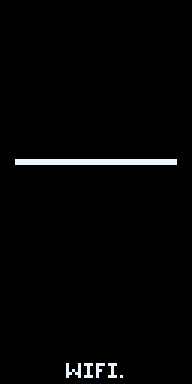
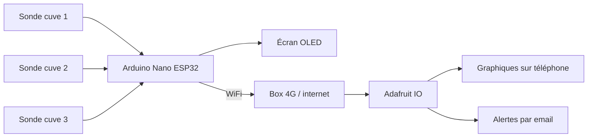
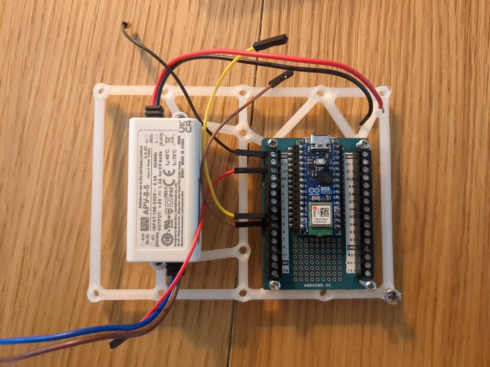
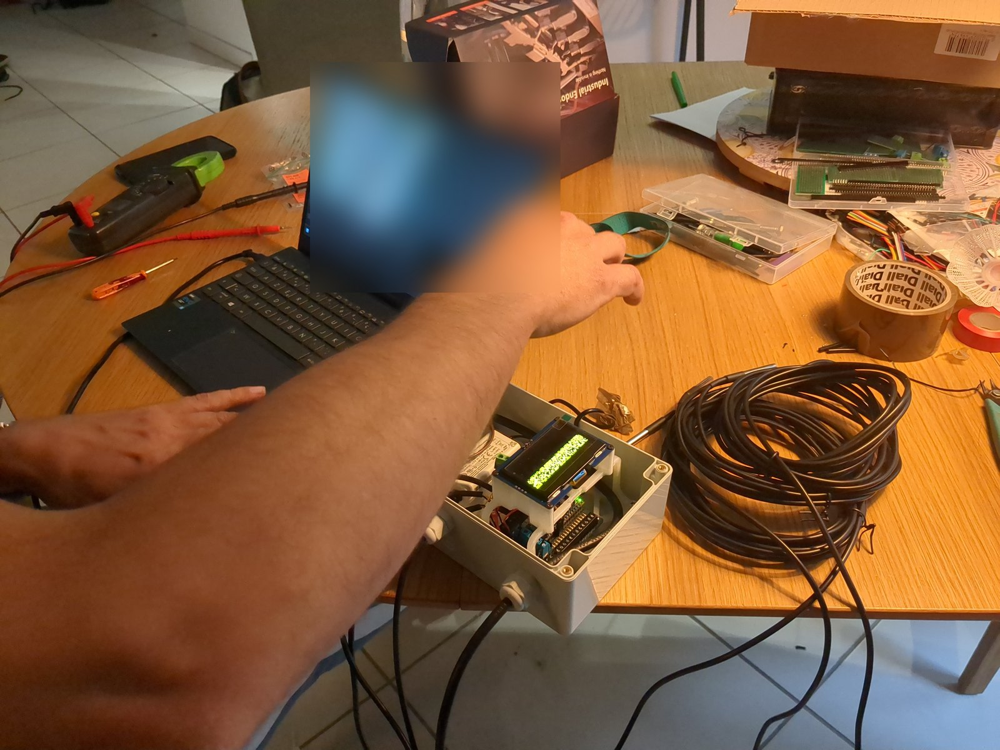
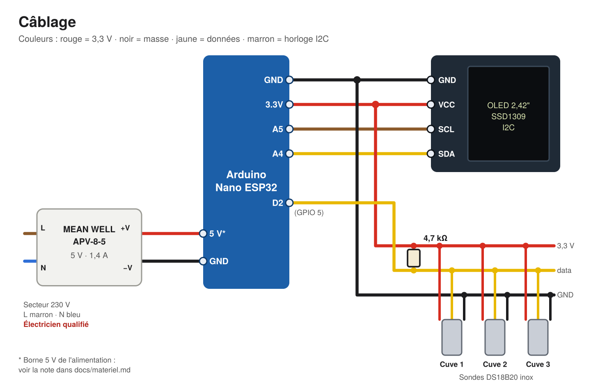

<p align="center">
  
</p>

<h1 align="center">All your tank are belong to us</h1>

<p align="center">
  <b>Surveillance de température pour cuves de brasserie</b><br>
  Arduino Nano ESP32 · sondes DS18B20 · écran OLED · tableau de bord Adafruit IO
</p>

> **In English:** a small, beginner-friendly temperature monitor for brewery tanks.
> An Arduino Nano ESP32 reads three waterproof DS18B20 probes, shows the
> temperatures on a portrait OLED screen and sends them to an Adafruit IO
> dashboard with e-mail alerts. Documentation is in French; the code is
> commented and all settings live in a single `config.h` file.

---

## Ce que ça fait

- **Mesure** la température de 3 cuves avec des sondes inox étanches, glissées dans les doigts de gant.
- **Affiche** sur place les 3 températures, le nom de chaque cuve et sa cible (par exemple `18.5±1`), sur un petit écran OLED vertical.
- **Alerte** à l'écran (bandeau « ALERTE » clignotant) et par email quand une cuve sort de sa fourchette, trop chaude ou trop froide, ou quand une sonde ne répond plus. L'email dit en clair ce qui se passe (« CHAUD 1 : 21.3 C (19±1), SONDE 3 »).
- **Envoie** les températures en ligne toutes les 20 secondes : graphiques sur téléphone et alertes par email via [Adafruit IO](https://io.adafruit.com) (gratuit).
- **Se règle à distance** : la température cible et la fourchette de chaque cuve se changent avec des curseurs, selon la levure et l'étape de fermentation. L'ESP32 s'en souvient après une coupure de courant.
- **Se met à jour par le WiFi** (OTA) : pas besoin d'ouvrir le boîtier pour changer le programme.
- **Continue sans internet** : si la box est en panne, l'écran affiche quand même les températures et les alertes (avec « HORS LIGNE »), et le boîtier se reconnecte tout seul.



## Le montage

| La platine | Le boîtier en test |
|:---:|:---:|
|  |  |

<p align="center">
  
</p>

## Démarrage rapide

1. **Le matériel** : la liste complète, avec les références, est dans [docs/materiel.md](docs/materiel.md).
2. **Le câblage** : suivez [docs/cablage.md](docs/cablage.md). La partie 230 V doit être faite par une personne qualifiée.
3. **Le logiciel** : installez l'Arduino IDE et les bibliothèques ([docs/installation.md](docs/installation.md)).
4. **Vos réglages** :
   - copiez `secrets.example.h` en `secrets.h` et mettez-y votre WiFi et votre clé Adafruit IO ;
   - trouvez l'adresse de vos sondes avec l'outil [`outils/scan-sondes`](outils/scan-sondes/scan-sondes.ino) et recopiez-la dans `config.h`.
5. **Le tableau de bord** : créez les feeds et les curseurs sur Adafruit IO ([docs/adafruit-io.md](docs/adafruit-io.md)), puis téléversez le programme.

## Adapter le projet à votre brasserie

Tout ce qui se règle est regroupé dans **un seul fichier**,
[`firmware/all-your-tank/config.h`](firmware/all-your-tank/config.h), commenté ligne par ligne :
broche des sondes, adresses et noms des cuves, cibles et fourchettes par défaut, noms des feeds,
fréquence d'envoi, type et orientation de l'écran.

Pour aller plus loin (autre écran, écran de démarrage, nombre de cuves différent) :
[docs/personnaliser.md](docs/personnaliser.md).

## Appli Android

Une appli pour suivre et régler les 3 cuves depuis le téléphone : cadrans, préréglages
(« Garde à froid »…), notifications d'alerte, mode clair et sombre, et un widget pour
l'écran d'accueil. Voir
[android-app/README.md](android-app/README.md).

## Organisation du dépôt

```text
all-your-tank/
├── firmware/all-your-tank/      Le programme à téléverser sur l'ESP32
│   ├── all-your-tank.ino        Programme principal (commenté)
│   ├── config.h                 ← vos réglages
│   ├── secrets.example.h        Modèle pour vos mots de passe (à copier en secrets.h)
│   └── ecran_demarrage.h        Écran de démarrage animé (l'œil)
├── outils/scan-sondes/          Petit programme pour trouver l'adresse des sondes
├── android-app/                 Appli Android (avec son widget)
├── docs/                        Toute la documentation
│   ├── materiel.md              Liste du matériel
│   ├── cablage.md               Câblage pas à pas
│   ├── installation.md          Arduino IDE, bibliothèques, téléversement
│   ├── adafruit-io.md           Tableau de bord et alertes email
│   ├── personnaliser.md         Adapter le projet
│   ├── depannage.md             Quand ça ne marche pas
│   └── ameliorations.md         Idées et améliorations prévues
└── logos/                       Le logo en PNG et SVG
```

## En cas de problème

Écran noir, « ERR. SONDE », blocage sur « WIFI... » ou « ADAFRUIT... »… La plupart des
pièges sont décrits dans [docs/depannage.md](docs/depannage.md), en particulier la
numérotation des broches du Nano ESP32, qui est différente des autres cartes ESP32.

## Contribuer

Les idées, corrections et adaptations à d'autres brasseries sont les bienvenues :
ouvrez une *issue* pour en discuter ou proposez une *pull request*. La liste des
améliorations envisagées est dans [docs/ameliorations.md](docs/ameliorations.md).

⚠️ Avant de partager votre version, vérifiez qu'aucun mot de passe ni clé
`aio_…` ne traîne dans vos fichiers (seul `secrets.h` doit les contenir, et il n'est
jamais publié).

## Licences

- **Code** (`firmware/`, `outils/`) : [MIT](LICENSE). Vous pouvez le réutiliser, le
  modifier et le redistribuer librement, en gardant la mention de licence.
- **Documentation, photos, schémas et logos** (`docs/`, `logos/`, image de `ecran_demarrage.h`) :
  [CC BY-SA 4.0](LICENSE-DOCS.md). Vous pouvez les réutiliser en citant le projet,
  et vos versions modifiées doivent rester sous la même licence.

Le nom est un clin d'œil au mème *« All your base are belong to us »* tiré du jeu
vidéo *Zero Wing* (1989).

## Remerciements

Ce projet repose sur les bibliothèques
[OneWire](https://github.com/PaulStoffregen/OneWire),
[DallasTemperature](https://github.com/milesburton/Arduino-Temperature-Control-Library),
[U8g2](https://github.com/olikraus/u8g2) et
[Adafruit IO Arduino](https://github.com/adafruit/Adafruit_IO_Arduino).
Merci à leurs auteurs.

Merci à mon pote Denis, pour le montage hardware et les impressions 3d 
