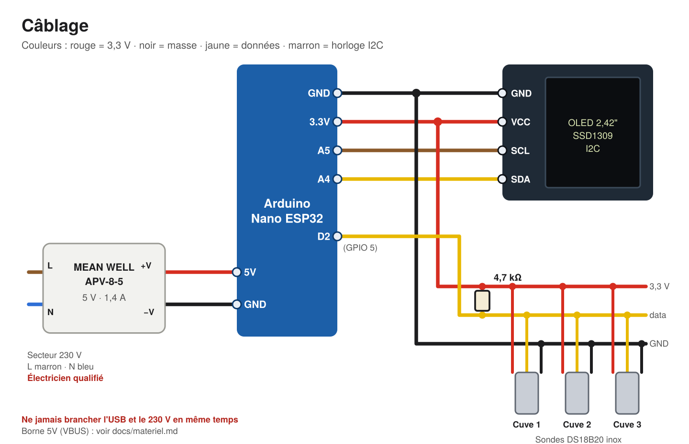
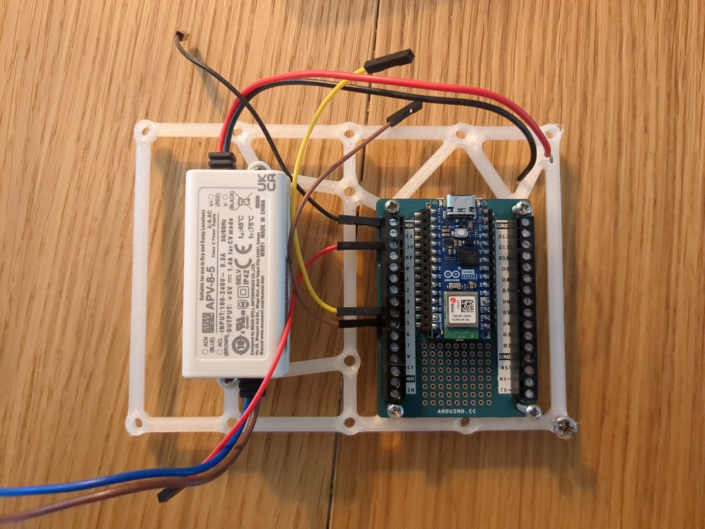
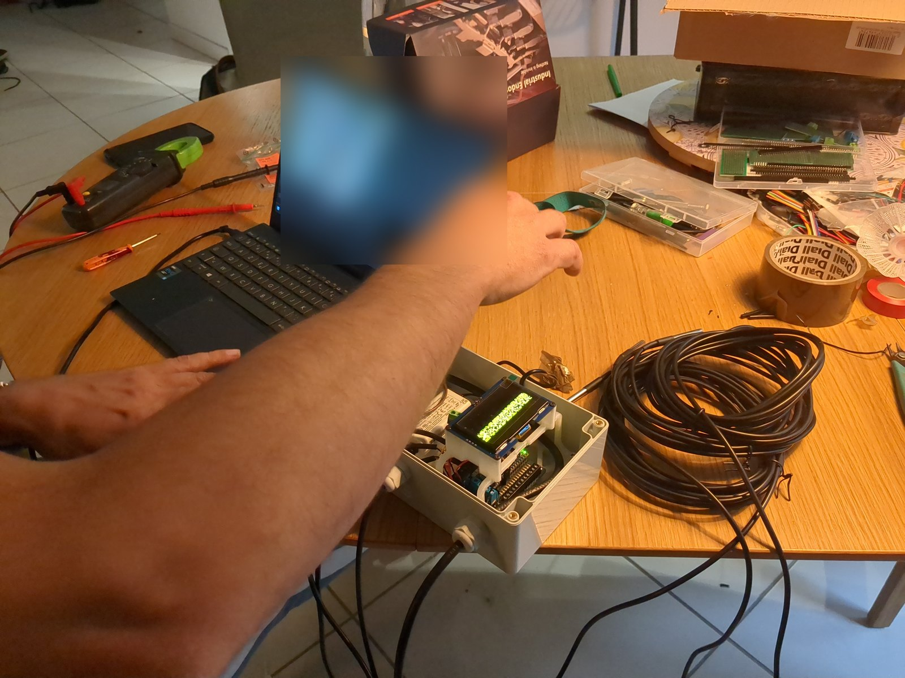

# Câblage

## Les branchements, borne par borne

Toutes les bornes sont sur l'adaptateur à bornier à vis du Nano ESP32.

### L'écran OLED (4 fils)

| Écran | Bornier du Nano | Couleur sur le montage |
|---|---|---|
| GND | GND | noir |
| VCC | 3.3V | rouge |
| SCL | A5 | marron |
| SDA | A4 | jaune |

### Les 3 sondes DS18B20 (en parallèle)

Les trois sondes partagent les mêmes trois bornes : on réunit tous les fils de même
couleur.

| Fils des sondes | Bornier du Nano |
|---|---|
| les 3 rouges (alimentation) | 3.3V |
| les 3 noirs (masse) | GND |
| les 3 jaunes (données) | D2 |

**Plus une seule résistance de 4,7 kΩ entre D2 et 3.3V.** Elle est indispensable :
sans elle, aucune sonde n'est détectée. Une seule suffit pour les 3 sondes.

> Certaines sondes ont des fils de couleurs différentes (par exemple blanc ou bleu
> pour les données). Vérifiez la fiche de vos sondes.

### L'alimentation

| Alimentation MEAN WELL | Destination |
|---|---|
| +V (rouge) | borne **5V** du Nano (VBUS) : voir le [point de vigilance](materiel.md#point-de-vigilance--lalimentation-5-v) |
| −V (noir) | GND |
| AC/L (marron) | phase du câble secteur |
| AC/N (bleu) | neutre du câble secteur |

⚡ **Le 230 V doit être raccordé par une personne qualifiée.**

⚠️ **Avant de brancher le câble USB pour reprogrammer la carte, débranchez le boîtier du secteur.**
L'alimentation et l'USB arrivent tous les deux sur la même ligne 5 V de la carte.

## Conseils de montage

- **Fixez les cartes avant de câbler.** Sur le montage d'origine, l'alimentation et le
  Nano sont vissés sur un support imprimé en 3D.
- **Presse-étoupes vers le bas** : l'eau ne peut pas remonter le long des câbles.
- **Serrez fermement** les presse-étoupes autour des câbles pour garder l'étanchéité.
- **Un sachet de gel de silice** dans le boîtier limite la condensation.
- **Rallonges de sondes** : rendez chaque raccord étanche avec de la gaine
  thermorétractable à colle, ou un boîtier de jonction rempli de résine.
- **Testez avant de fermer** : branchez, téléversez et vérifiez que les 3 sondes et
  l'écran fonctionnent avant de visser le couvercle.

## Les photos du montage

*La platine : l'alimentation MEAN WELL à gauche, le Nano ESP32 sur son bornier à vis à
droite. Les 4 fils de l'écran sont déjà branchés sur GND, 3.3V, A4 et A5.*

*Les essais : l'écran est fixé au-dessus de la platine, les sondes attendent à côté.*
