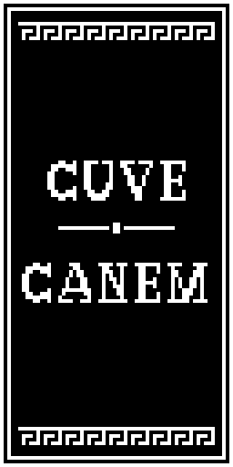
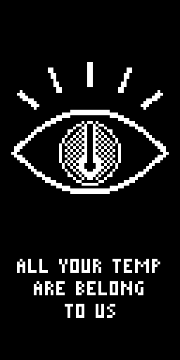
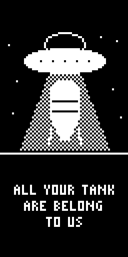

# Adapter le projet à votre brasserie

La plupart des réglages sont dans [`config.h`](../firmware/all-your-tank/config.h).
Après chaque modification, téléversez à nouveau le programme (par USB ou par le WiFi).

## Renommer une cuve ou changer un seuil

Pas besoin de toucher au code : faites-le depuis le tableau de bord Adafruit IO
(feeds `nom-cuveX` et `seuil-cuveX`, voir [adafruit-io.md](adafruit-io.md)).
L'écran n'affiche que les **6 premiers caractères** du nom. Évitez les accents :
les polices de l'écran les affichent mal.

Les valeurs `NOMS_DEFAUT` et `SEUILS_DEFAUT` de `config.h` ne servent qu'au tout
premier démarrage, avant la première synchronisation.

## Remplacer ou ajouter une sonde

1. Lancez l'outil `outils/scan-sondes` ([installation.md](installation.md#6-trouver-ladresse-de-vos-sondes)).
2. Recopiez la nouvelle adresse dans `ADRESSE_SONDE_1`, `_2` ou `_3` de `config.h`.

Si une sonde est débranchée ou mal adressée, l'écran affiche **ERR. SONDE** pour
cette cuve, et rien n'est envoyé en ligne pour elle.

## Changer la borne des sondes

Modifiez `ONE_WIRE_BUS` dans `config.h`. Attention : il faut y mettre le **numéro de
GPIO**, pas l'étiquette du bornier (D2 correspond au GPIO 5). Voir le tableau dans
[depannage.md](depannage.md#les-numéros-de-broches-du-nano-esp32).

## Changer la fréquence d'envoi

`INTERVALLE_ENVOI_MS` (en millisecondes, 20000 = 20 secondes). Chaque envoi compte
pour 3 valeurs (une par cuve), et le compte gratuit Adafruit IO en accepte 30 par
minute. Ne descendez pas sous **10000** (10 secondes) pour garder de la marge.

## Utiliser un autre écran

1. Trouvez le nom de votre écran dans la
   [liste des constructeurs U8g2](https://github.com/olikraus/u8g2/wiki/u8g2setupcpp)
   (par exemple `U8G2_SSD1306_128X64_NONAME_F_HW_I2C` pour un petit OLED 0,96").
2. Mettez-le dans `ECRAN_TYPE`.
3. L'affichage est dessiné pour un écran **en portrait de 64 × 128 pixels**
   (`ECRAN_ROTATION U8G2_R1`). Pour un écran de taille différente, il faudra ajuster
   les positions dans la fonction `dessinerCuve()` et dans `loop()`.

## Afficher un logo au démarrage

Le fichier [`ecrans_demarrage.h`](../firmware/all-your-tank/ecrans_demarrage.h)
contient 3 écrans de démarrage prêts à l'emploi (64 × 128 pixels) :

| `cuve_canem` | `all_your_temp_oeil` | `all_your_tank_soucoupe` |
|:---:|:---:|:---:|
|  |  |  |

Pour en afficher un pendant 3 secondes au démarrage :

1. En haut de `all-your-tank.ino`, sous `#include "config.h"`, ajoutez :
   ```cpp
   #include "ecrans_demarrage.h"
   ```
2. Dans `setup()`, juste après la ligne `u8g2.begin();`, ajoutez :
   ```cpp
   u8g2.firstPage();
   do {
     u8g2.drawXBMP(0, 0, cuve_canem_width, cuve_canem_height, cuve_canem_bits);
   } while (u8g2.nextPage());
   delay(3000);
   ```
3. Remplacez `cuve_canem` par le nom de l'écran de votre choix.

Les versions PNG et SVG de ces logos sont dans le dossier [`logos/`](../logos).

## Changer les textes affichés

Les messages (« Bonjour ! », « Temp OK ! », « ALERTE »…) sont écrits directement
dans `all-your-tank.ino`. Gardez-les courts : l'écran ne fait que 64 pixels de large,
soit environ 10 caractères. Évitez les accents.

## Surveiller 2 ou 4 cuves au lieu de 3

Le programme est écrit pour 3 cuves. Pour changer ce nombre, il faut modifier
plusieurs endroits du code :

- les tableaux de taille `[3]` et les boucles `for (int i = 0; i < 3; i++)` ;
- les feeds et les fonctions `cbN0`… `cbS2` (une par cuve) ;
- les adresses de sondes, noms et seuils dans `config.h` ;
- la mise en page de l'écran dans `loop()` (une bande de 34 pixels par cuve).

Ce chantier figure dans la liste des [améliorations](ameliorations.md).
