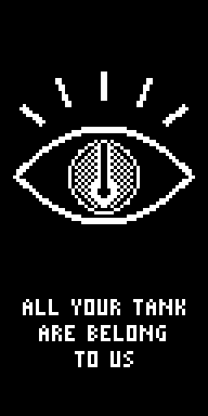

# Adapter le projet à votre brasserie

La plupart des réglages sont dans [`config.h`](../firmware/all-your-tank/config.h).
Après chaque modification, téléversez à nouveau le programme (par USB ou par le WiFi).

## Changer la cible ou la fourchette d'une cuve

Pas besoin de toucher au code : utilisez les curseurs du tableau de bord Adafruit IO
(feeds `cible-cuveX` et `fourchette-cuveX`, voir [adafruit-io.md](adafruit-io.md)).
Par exemple, cible `19` et fourchette `1` : tout va bien entre 18 et 20 °C.

Les valeurs `CIBLES_DEFAUT` et `FOURCHETTES_DEFAUT` de `config.h` ne servent qu'au tout
premier démarrage, avant la première synchronisation.

## Renommer une cuve

Les noms sont fixés dans `config.h`, ligne `NOMS_CUVES` (pour garder les 10 feeds du
compte gratuit pour les cibles et fourchettes). L'écran n'affiche que les
**6 premiers caractères**. Évitez les accents : les polices de l'écran les affichent mal.

## Changer la marge anti-clignotement

`HYSTERESIS` (0,2 °C par défaut) : une cuve en alerte doit revenir de cette marge à
l'intérieur de sa fourchette pour que l'alerte s'arrête. Augmentez-la si vous recevez
trop d'emails quand la température hésite sur une limite.

## Remplacer ou ajouter une sonde

1. Lancez l'outil `outils/scan-sondes` ([installation.md](installation.md#6-trouver-ladresse-de-vos-sondes)).
2. Recopiez la nouvelle adresse dans `ADRESSE_SONDE_1`, `_2` ou `_3` de `config.h`.

Si une sonde est débranchée ou mal adressée, l'écran affiche **ERR. SONDE** pour
cette cuve, et rien n'est envoyé en ligne pour elle.

## Changer la borne des sondes

Modifiez `ONE_WIRE_BUS` dans `config.h`. Attention : il faut y mettre le **numéro de
GPIO**, pas l'étiquette du bornier (D2 correspond au GPIO 5). Voir le tableau dans
[depannage.md](depannage.md#les-numéros-de-broches-du-nano-esp32).

## Changer la fréquence d'envoi

`INTERVALLE_ENVOI_MS` (en millisecondes, 20000 = 20 secondes). Chaque envoi compte
pour 3 valeurs (une par cuve), et le compte gratuit Adafruit IO en accepte 30 par
minute. Ne descendez pas sous **10000** (10 secondes) pour garder de la marge.

## Utiliser un autre écran

1. Trouvez le nom de votre écran dans la
   [liste des constructeurs U8g2](https://github.com/olikraus/u8g2/wiki/u8g2setupcpp)
   (par exemple `U8G2_SSD1306_128X64_NONAME_F_HW_I2C` pour un petit OLED 0,96").
2. Mettez-le dans `ECRAN_TYPE`.
3. L'affichage est dessiné pour un écran **en portrait de 64 × 128 pixels**
   (`ECRAN_ROTATION U8G2_R1`). Pour un écran de taille différente, il faudra ajuster
   les positions dans la fonction `dessinerCuve()` et dans `loop()`.

## L'écran de démarrage

Au démarrage, l'écran affiche une petite animation pendant la connexion : l'œil
s'ouvre, les rayons s'allument, puis « ALL YOUR TANK ARE BELONG TO US » s'écrit
lettre par lettre. En bas, en petit, l'étape en cours (« WIFI... », « ADAFRUIT... »,
« CONNECTE ! »). Le logo reste encore 2 secondes une fois connecté.

Tout se trouve dans [`ecran_demarrage.h`](../firmware/all-your-tank/ecran_demarrage.h) :

- **la vitesse** : les durées en millisecondes (`PAS_LETTRE`, `PERIODE_CLIGNEMENT`…) ;
- **le logo** : l'image `logo_oeil_bits` (64 × 128 pixels, format XBM). Pour la
  remplacer, dessinez votre image en noir et blanc, convertissez-la en XBM (par exemple
  avec GIMP : *Exporter sous… → .xbm*), collez les nombres à la place des anciens, et
  ajustez les repères (lignes de l'œil, rectangles des rayons, position des lettres).

Les versions PNG et SVG du logo sont dans le dossier [`logos/`](../logos).

## Changer les textes affichés

Les messages (« Bonjour ! », « Temp OK ! », « ALERTE »…) sont écrits directement
dans `all-your-tank.ino`. Gardez-les courts : l'écran ne fait que 64 pixels de large,
soit environ 10 caractères. Évitez les accents.

## Surveiller 2 ou 4 cuves au lieu de 3

Le programme est écrit pour 3 cuves. Pour changer ce nombre, il faut modifier
plusieurs endroits du code :

- les tableaux de taille `[3]` et les boucles `for (int i = 0; i < 3; i++)` ;
- les feeds et les fonctions `cbC0`… `cbF2` (une par cuve), en restant sous 10 feeds sur le compte gratuit ;
- les adresses de sondes, noms, cibles et fourchettes dans `config.h` ;
- la mise en page de l'écran dans `loop()` (une bande de 34 pixels par cuve).

Ce chantier figure dans la liste des [améliorations](ameliorations.md).
